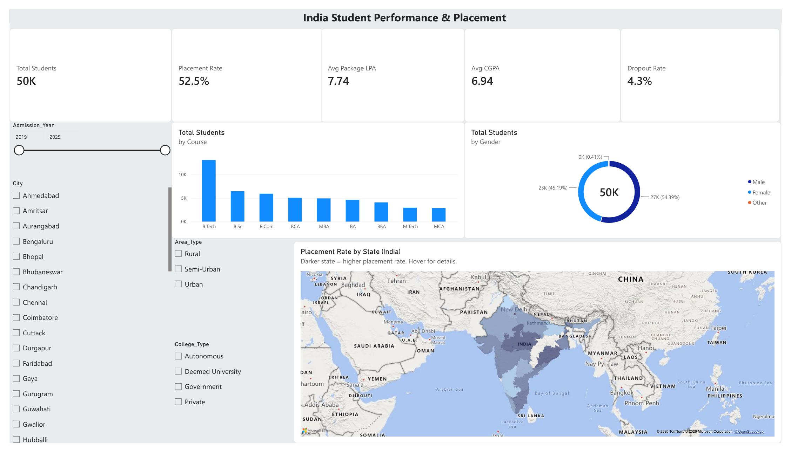
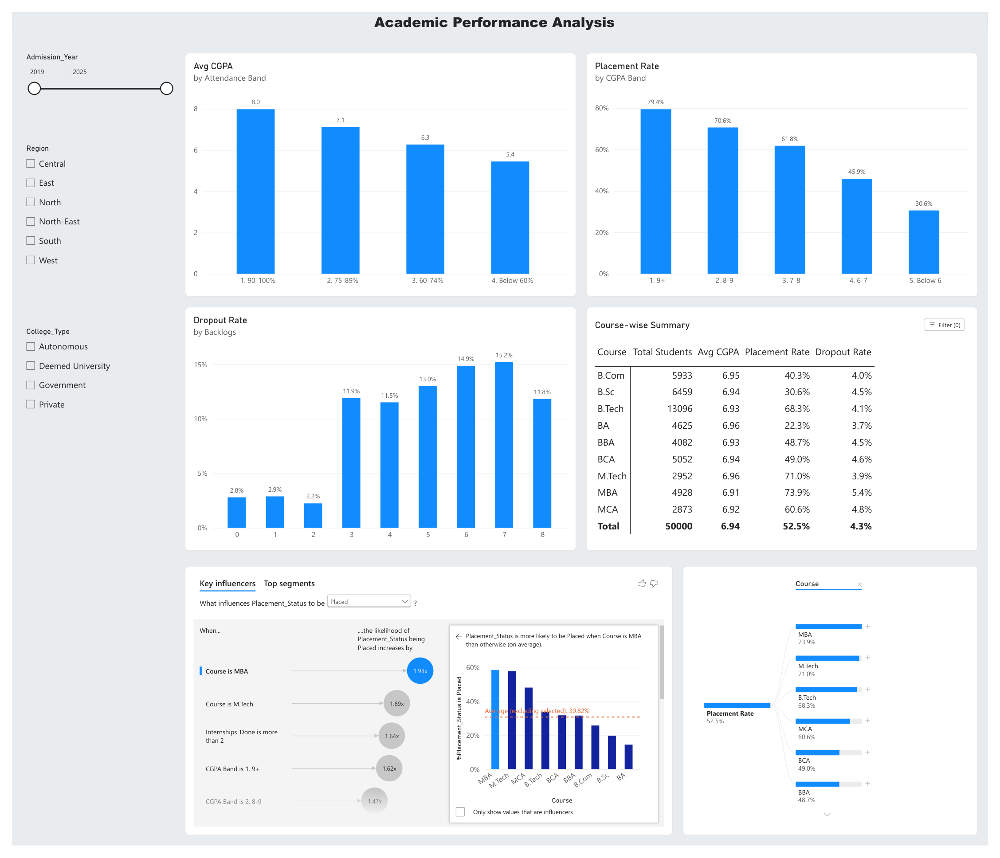
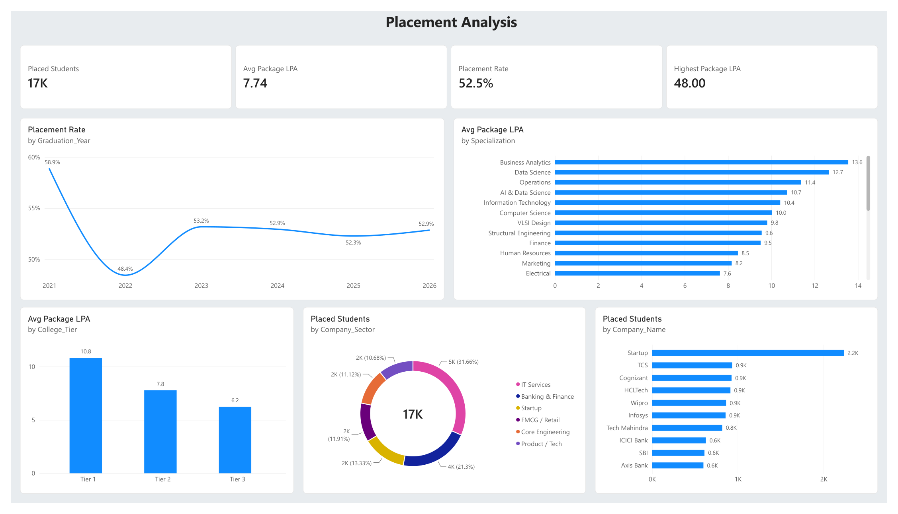

# 🎓 India Student Performance & Placement Dashboard (Power BI)

An interactive **Power BI** dashboard that analyses **50,000 student records** across **17 Indian states, ~150 colleges and 9 courses** to find what drives academic performance, dropouts and campus placements.



---

## 📌 Project Objective

- Understand how **attendance, CGPA and backlogs** affect academic results.
- Find which **courses, specializations and college tiers** lead to better placements and packages.
- Use **AI visuals** to identify the key factors that increase a student's chance of being placed.

---

## 🛠️ Tools & Skills

| Area | Used |
|---|---|
| Visualization | Power BI Desktop |
| Data cleaning | Power Query (data types, summarization) |
| Calculations | DAX measures & calculated columns |
| Visuals | KPI cards, column/bar/line/donut charts, matrix, filled map, slicers |
| AI visuals | Key Influencers, Decomposition Tree |
| Data generation | Python (standard library) |

---

## 📂 Repository Structure

```
├── dashboard/
│   ├── Student_Dashboard.pbix     # Power BI report (open in Power BI Desktop)
│   └── Student_Dashboard.pdf      # PDF export of all pages
├── data/
│   └── India_Student_Performance_Placement_50K.csv   # 50,000 rows x 37 columns
├── images/                        # Dashboard screenshots
├── scripts/
│   └── generate_dataset.py        # Script that generated the dataset
└── README.md
```

---

## 🗂️ Dataset

> ⚠️ **Note:** This is a **synthetic dataset modelled on Indian higher-education data**, created because large, clean public datasets were not available. It does not contain real student information. Relationships between variables are built in so the analysis reflects realistic patterns.

**50,000 rows × 37 columns**, including:

- **Student:** ID, name, gender, age, category (General/OBC/SC/ST/EWS), area type, family income
- **Location:** state, city, region
- **College:** name, type (Government/Private/Deemed/Autonomous), tier (1/2/3)
- **Academics:** course, specialization, 10th %, 12th %, entrance score, attendance %, CGPA, backlogs
- **Finance:** annual fee, scholarship, scholarship amount
- **Outcome:** study status, placement status, company sector, company, package (LPA)

To regenerate it:
```bash
python scripts/generate_dataset.py data/India_Student_Performance_Placement_50K.csv
```

---

## 🧮 Key DAX Measures

```DAX
Total Students      = COUNTROWS(Students)
Graduates           = CALCULATE([Total Students], Students[Study_Status] = "Graduated")
Placed Students     = CALCULATE([Total Students], Students[Placement_Status] = "Placed")
Placement Rate      = DIVIDE([Placed Students], [Graduates])
Avg Package LPA     = AVERAGE(Students[Package_LPA])
Highest Package LPA = MAX(Students[Package_LPA])
Avg CGPA            = AVERAGE(Students[CGPA])
Dropout Rate        = DIVIDE(CALCULATE([Total Students], Students[Study_Status] = "Dropped Out"), [Total Students])
Scholarship Rate    = DIVIDE(CALCULATE([Total Students], Students[Scholarship] = "Yes"), [Total Students])
```

**Calculated columns:** `Attendance Band`, `CGPA Band` (using `SWITCH(TRUE(), ...)`) and `State Location` (`State & ", India"`, so the map plots states inside India).

---

## 📊 Dashboard Pages

### 1. Overview
KPI cards (Total Students, Placement Rate, Avg Package, Avg CGPA, Dropout Rate), students by course and gender, a **filled map of India shaded by placement rate**, and slicers for year, city, area type and college type.

### 2. Academic Performance
Attendance vs CGPA, CGPA vs placement, backlogs vs dropout, a course-wise summary matrix, plus **AI visuals**:
- **Key Influencers** — what increases the likelihood of a student being *Placed*
- **Decomposition Tree** — drill into placement rate by course, college tier, CGPA band and gender



### 3. Placement Analysis
Placement KPIs, yearly placement trend, average package by specialization and college tier, placements by company sector and the **Top 10 hiring companies**.



---

## 💡 Key Insights

1. Overall **placement rate is 52.5%**, with an **average package of 7.74 LPA** and a **highest package of 48 LPA**.
2. **Attendance drives CGPA:** 90–100% attendance → **8.0** avg CGPA vs **5.4** below 60%.
3. **CGPA drives placement:** CGPA 9+ → **79.4%** placed vs **30.6%** below 6.
4. **Backlogs drive dropout:** 0–2 backlogs → **~2–3%** dropout vs **12–15%** with 3 or more.
5. **Course matters:** MBA (**73.9%**), M.Tech (**71.0%**) and B.Tech (**68.3%**) have the best placement rates; BA is lowest (**22.3%**).
6. **Key Influencers:** MBA students are **1.93x** more likely to be placed; M.Tech, **more than 2 internships** and **CGPA 9+** are the next strongest drivers.
7. **Specialization pays:** Business Analytics (**13.6 LPA**) and Data Science (**12.7 LPA**) have the highest average packages; Electrical the lowest (**7.6 LPA**).
8. **College tier matters:** Tier 1 averages **10.8 LPA** vs **7.8** (Tier 2) and **6.2** (Tier 3).
9. **IT Services** is the largest recruiting sector (~**32%** of placements).
10. **2022** had the lowest placement rate (**48.4%**), recovering to ~**52–53%** from 2023.

---

## ✅ Conclusion

Regular attendance and a strong CGPA are the biggest factors in getting placed, and internships add a clear advantage. Students who build up backlogs are at much higher risk of dropping out, so colleges should identify and support them early. Data and analytics specializations, and Tier 1 colleges, lead to noticeably higher packages.

---

## ▶️ How to Use

1. Install **[Power BI Desktop](https://powerbi.microsoft.com/desktop/)** (free).
2. Open `dashboard/Student_Dashboard.pbix`.
3. If prompted for the data source, point it to `data/India_Student_Performance_Placement_50K.csv` (*Transform data → Data source settings → Change source*).
4. Use the slicers to filter; click any chart to cross-filter the page.
5. The map needs an internet connection to load.

Prefer not to install anything? See the **[PDF export](dashboard/Student_Dashboard.pdf)**.
